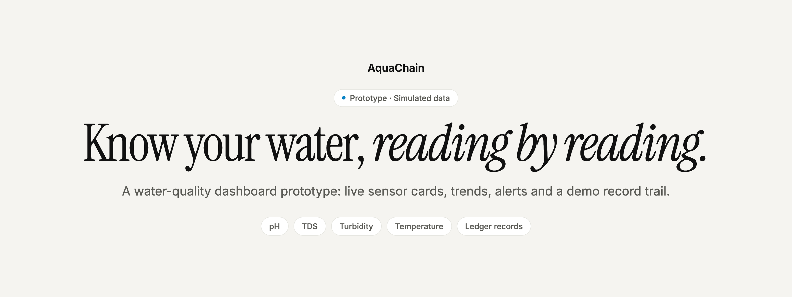
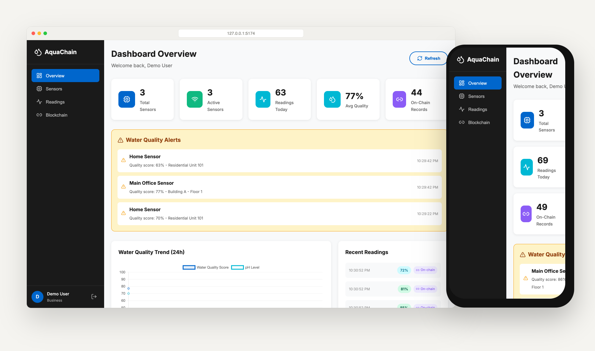
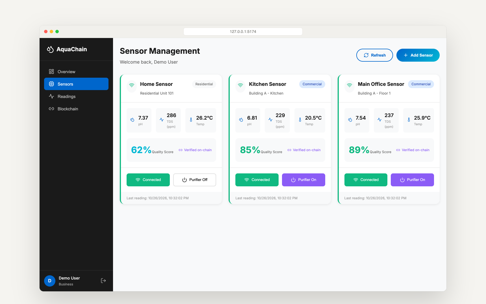
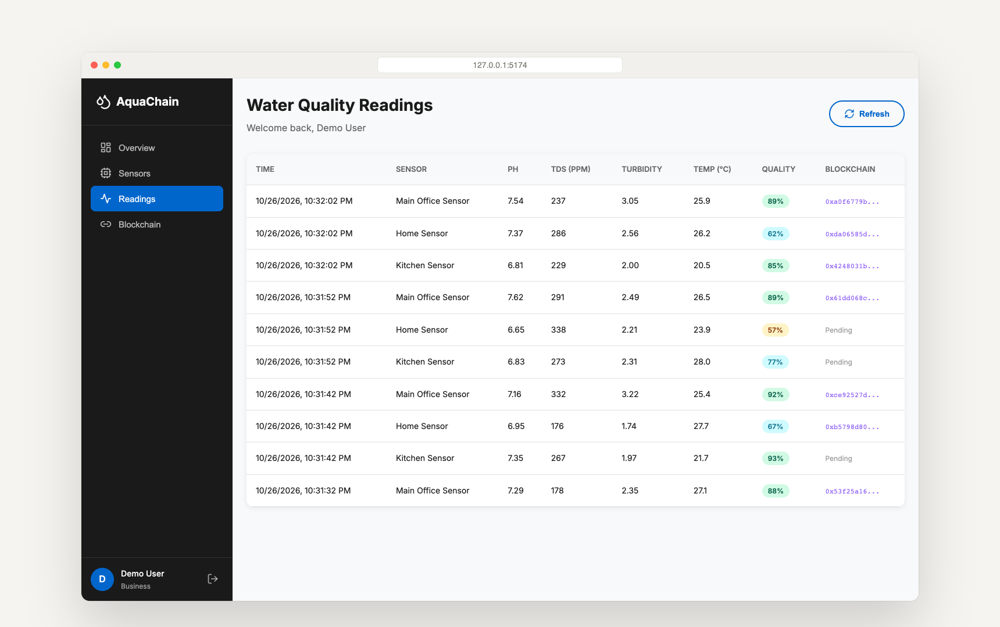
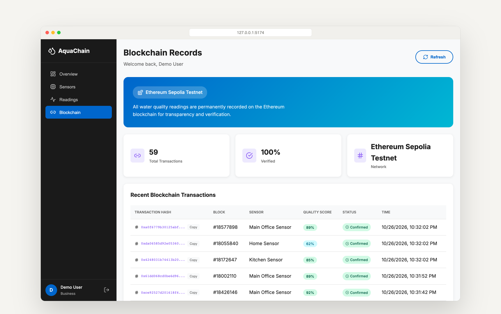
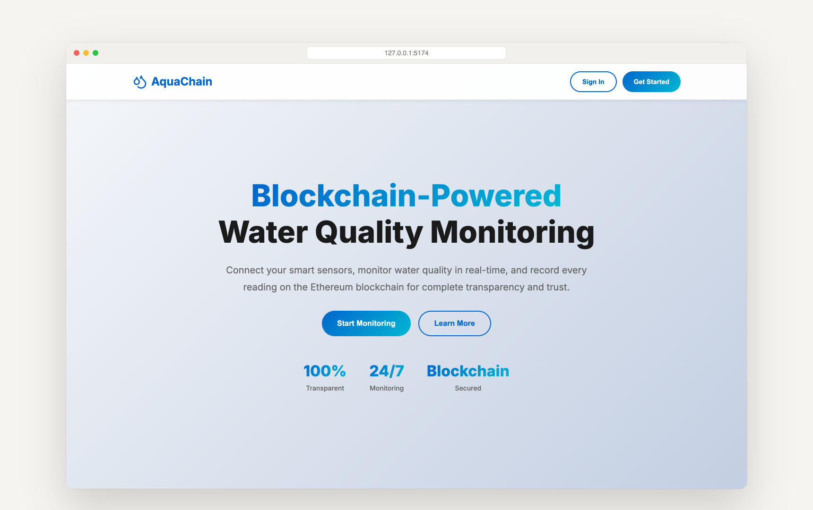
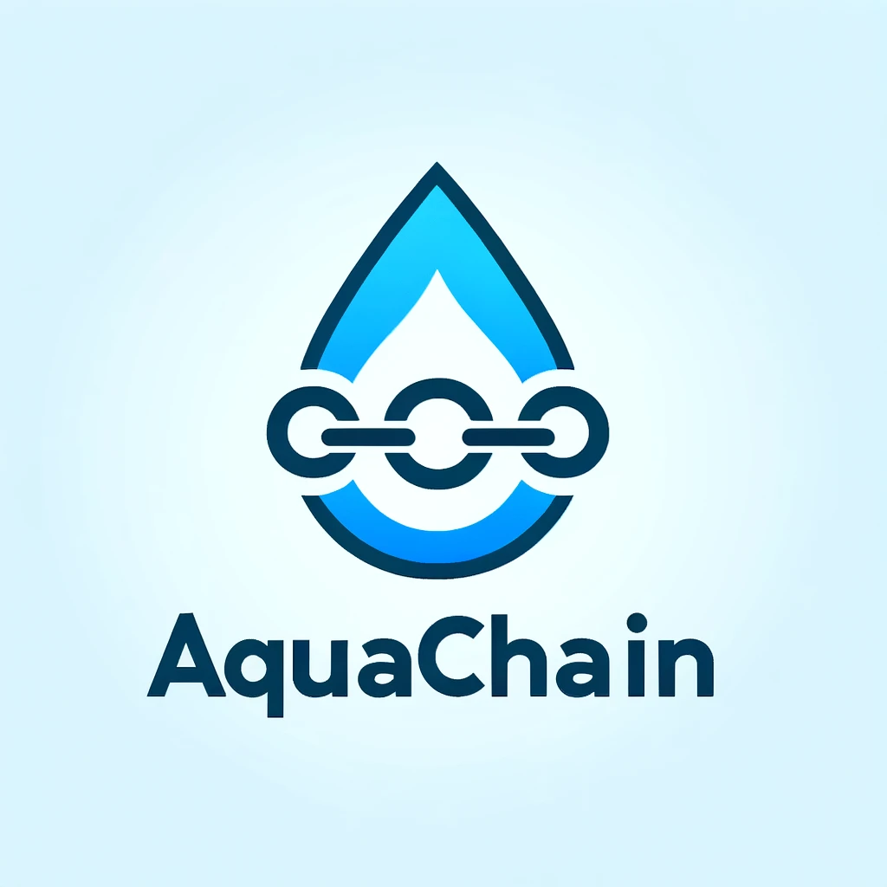

<p align="center">
  <picture>
    <source media="(prefers-color-scheme: dark)" srcset=".github/assets/banner-dark.png">
    
  </picture>
</p>

<p align="center">
  <strong>Water quality you can see, check and trace.</strong><br>
  A full-stack prototype that turns sensor readings (pH, TDS, turbidity, temperature) into a live dashboard, with an audit-style record trail for the readings.
</p>

<p align="center">
  <a href="#run-it-locally"><strong>Run it</strong></a> ·
  <a href="#a-quick-tour"><strong>Tour</strong></a> ·
  <a href="#how-it-works"><strong>How it works</strong></a> ·
  <a href="#honest-status"><strong>Honest status</strong></a> ·
  <a href="#venture-materials"><strong>Venture materials</strong></a>
</p>

<p align="center">
  
  
  
  
</p>

<p align="center">
  
</p>

## Why AquaChain

Most people never see what is in their water. Lab tests are occasional, home test strips are fiddly, and when a building manager says the water is fine, there is rarely a record anyone else can check.

**AquaChain explores a simpler loop:** sensors report every few seconds, a dashboard turns those numbers into one quality score and plain alerts, and readings get a record that someone else could later verify. This repository is the working software prototype of that idea, plus the venture research behind it.

<table>
  <tr>
    <td width="33%" valign="top">
      <h3>💧 One glance</h3>
      Each sensor shows pH, dissolved solids and temperature, rolled into a single quality score from 0 to 100%.
    </td>
    <td width="33%" valign="top">
      <h3>⚡ Live, not monthly</h3>
      New readings arrive every 10 seconds over WebSockets. Anything outside pH 6.5–8.5, above 500 ppm TDS or under a 50% score becomes an alert.
    </td>
    <td width="33%" valign="top">
      <h3>🔗 A record trail</h3>
      Readings are paired with ledger-style records you can look up by hash. Today those records are simulated; the design shows where on-chain verification would fit.
    </td>
  </tr>
</table>

## A quick tour

<table>
  <tr>
    <td width="50%" valign="top">
      
      <h4>Sensors</h4>
      Add sensors, connect or disconnect them, and switch the simulated purifier on or off.
    </td>
    <td width="50%" valign="top">
      
      <h4>Readings</h4>
      Every measurement in one table, colour-coded by quality, with its record status.
    </td>
  </tr>
  <tr>
    <td width="50%" valign="top">
      
      <h4>Record trail</h4>
      A ledger view of the reading records. The hashes and block numbers are randomly generated, not real Ethereum transactions.
    </td>
    <td width="50%" valign="top">
      
      <h4>Landing page</h4>
      A marketing page with sign-in and sign-up for household or business accounts.
    </td>
  </tr>
</table>

<sub>Screenshots are from this code running locally on 26 October 2026 with the built-in demo account and simulated readings. Some UI copy (such as "permanently recorded on the Ethereum blockchain") describes the product vision, not what the prototype does today.</sub>

## How it works

```text
 Sensor simulator ──▶ Express API ──▶ PostgreSQL
 (every 10 s)          │   (JWT auth)     users · sensors · readings · records
                       │
                       └──▶ Socket.IO ──▶ React dashboard (Chart.js)
```

- **Client:** React 18 and Vite, Chart.js charts, Lucide icons, in `client/`.
- **Server:** Express with JWT sign-in (bcrypt passwords), REST routes for sensors, readings, dashboard stats and records, and Socket.IO for live updates, in `server/`.
- **Simulation:** `server/utils/sensorSimulator.js` generates a reading for every connected sensor every 10 seconds and attaches a random 64-character hash and block number to about 70% of them.

## Run it locally

**You need:** Node.js 18 or newer and a local PostgreSQL database you can throw away.

```bash
npm install
npm --prefix client install
```

Create a `.env` file in the repository root (it stays out of Git):

```bash
DATABASE_URL=postgresql://localhost:5432/aquachain
JWT_SECRET=<a long random string>
```

```bash
npm run dev
```

The API starts on port 5001, creates its tables and seeds a demo account with three sensors. The Vite client asks for port 5000 and moves to the next free port if that one is taken (on macOS the AirPlay Receiver often holds 5000), so open the URL Vite prints.

| Command | What it does |
| --- | --- |
| `npm run dev` | API and client together, with live reload |
| `npm run build` | Production build of the client into `client/dist` |
| `npm start` | API in production mode, also serving `client/dist` |

<details>
<summary><strong>API routes</strong></summary>
<br>

| Route | What it does |
| --- | --- |
| `POST /api/auth/register`, `POST /api/auth/login`, `GET /api/auth/me` | Accounts with household or business roles |
| `GET/POST /api/sensors`, `GET/PUT/DELETE /api/sensors/:id` | List, add, edit and remove sensors |
| `PATCH /api/sensors/:id/connect`, `/disconnect`, `/purifier` | Connection and purifier switches |
| `GET /api/readings/sensor/:id`, `/latest/:id`, `/history/:id` | Readings per sensor |
| `GET /api/dashboard/stats`, `/recent-readings`, `/quality-trend`, `/alerts` | Dashboard data |
| `GET /api/blockchain/transactions`, `/stats`, `POST /record`, `GET /verify/:txHash` | Simulated record trail |

Every route except sign-up, sign-in and `verify` needs a `Bearer` token.

</details>

## Honest status

AquaChain is a **demonstration, not a deployed water-safety system**.

- Sensor readings are **simulated**. No physical sensor integration is included.
- Record hashes and block numbers are **randomly generated**. Nothing is submitted to Ethereum or any other network, even though the UI labels them "Sepolia testnet".
- The purifier switch only changes a database flag (and the simulated quality range).
- The landing page's marketing copy (for example "join thousands of users") is placeholder text; there are no users.
- Startup seeds a demo account, so only point it at a local development database.
- There are no automated tests.

The broader product direction lives in the venture documents below.

## Venture materials

This repository also holds the team's commercialization work: the opportunity pitch and report, potential and down-selected concepts, a production development plan, a bill of materials, competitor and SWOT analysis, risk management, market sizing and the business model. Open the `.docx`, `.pptx` and `.xlsx` files in any compatible viewer.

## License

No license file is included. This README grants no reuse or redistribution rights; contact the repository owner about permitted use.

<p align="center">
  <br>
  <br>
  <sub><strong>AquaChain</strong> · Know your water.</sub>
</p>
